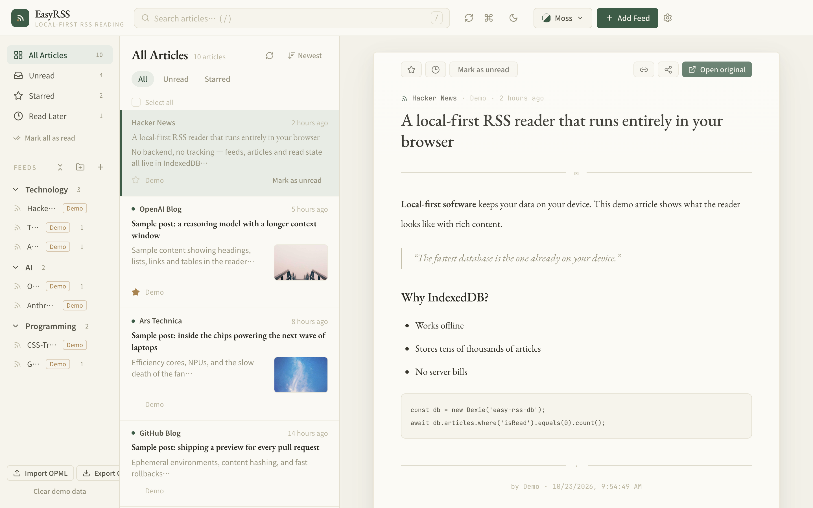
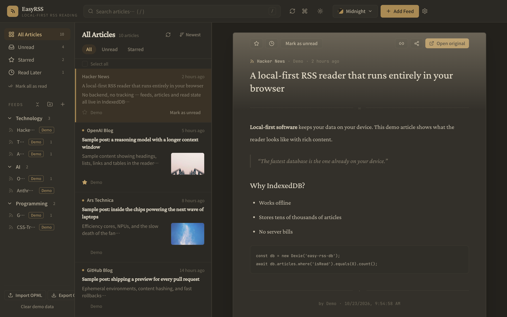

# EasyRSS — Local-First RSS Reader

[](../../actions/workflows/ci.yml) [](LICENSE)

[中文](README.md) · **English** · **[Live demo](https://easy-rss.pages.dev)**

A **frontend-only, local-first** RSS reader: subscribe, fetch and parse RSS/Atom,
read in a three-pane workspace, star and organize, search, import/export OPML.
All data lives in your browser — no backend, no account, no telemetry.

- **Local first**: open the app, read history and search offline
- **Frontend-only**: IndexedDB + localStorage; any static host will do
- **Pluggable fetching**: the fetch channel is a `FetchProxy` strategy layer — plug in your own proxy or a Cloudflare Worker without touching business code

<p align="center">
  
  
</p>

## Features

- **Subscriptions**: add / delete / rename / move, folders, OPML import & export
- **Smart views**: All / Unread / Starred / Read later, live unread counts
- **Three-pane workspace**: sidebar ↔ article list ↔ letter-style reader, draggable & persisted pane widths
- **Article list**: All / Unread / Starred filters, newest/oldest sort, infinite scroll, bulk actions
- **Reader**: DOMPurify-sanitized HTML, serif typography, lazy images, star / read-later / copy link / Web Share / open original
- **10 themes**: 7 light + 3 dark, with separate light/dark slots when following the system; no flash on first paint
- **Search & palette**: live search plus a `⌘K` / `Ctrl K` command palette
- **Keyboard shortcuts**: `j` `k` `o` `s` `m`/`u` `r` `/` `?`
- **Refresh**: per-feed / all, auto refresh (manual ~ 24h), visibility- and online-aware
- **Mobile**: drawer sidebar, bottom nav, full-screen reader
- **Offline & PWA**: manifest + service worker (cache name rotates per build)
- **Bilingual UI** (中文 / English); demo data on first run, one click to clear

## Tech stack

React 18 · TypeScript 5.6 (strict) · Vite 6 · Tailwind CSS v4 · Zustand 5 · TanStack Query 5 · React Router 7 · Dexie 4 (IndexedDB) · DOMPurify 3 · Lucide · Vitest

Requires Node 18+ (20+ recommended).

## Quick start

```bash
npm install
npm run dev      # http://localhost:3100
npm run build    # tsc -b && vite build → dist/
npm run preview  # preview the production build
npm test         # unit tests (Vitest)
npm run check    # lint + test + build
```

> The live demo is a plain static deployment with **no fetch proxy configured**, so feeds that block
> cross-origin requests will fail to refresh (the seeded demo data is unaffected). To read arbitrary feeds,
> run it locally with a [self-hosted proxy](#self-hosted-proxy-optional).

### Deploying as a static site (Cloudflare Pages, etc.)

```bash
npm run build:public   # NOT `npm run build` — see the warning below
npx wrangler pages deploy dist --project-name <your-project>
```

> ⚠️ Vite compiles every `VITE_*` variable from `.env` **into the public JS bundle**. If your local `.env`
> has a `VITE_RSS_PROXY_URL` containing a token, deploying the output of `npm run build` exposes that token
> to every visitor. `npm run build:public` overrides those variables. Sanity check before deploying:
> `grep -r "<your token>" dist` must print nothing.

## Configuration

Copy `.env.example` to `.env` and restart the dev server after changes:

```bash
VITE_RSS_PROXY=auto      # auto | direct | custom | allorigins | corslol | codetabs
VITE_RSS_PROXY_URL=https://your-proxy.example.com/?token=<TOKEN>&url={url}
```

`{url}` is replaced with the URL-encoded feed address.

### CORS and the proxy layer

Many feeds block cross-origin browser requests. Fetching is abstracted as `FetchProxy`
strategies (`src/services/rss/fetcher.ts`):

- **`auto` (default)**: direct (5s) → your own proxy if configured (10s) → an error with per-strategy diagnostics
- **Public proxies are off by default**: they leak your subscription URLs and are rate-limited; kept only as explicit opt-ins
- **Circuit breaker**: an unreachable strategy is skipped for 5 minutes
- **Concurrency**: `refreshAll` fetches with 3 workers

### Self-hosted proxy (optional)

`server/rss-proxy/` is a zero-dependency Node proxy (token auth, SSRF protection,
timeout/size limits, `/healthz`) that listens on `127.0.0.1` only:

```bash
cd server/rss-proxy
./deploy.sh root@<your-vps>   # installs Node, creates a user, registers systemd, health-checks
```

Then open an SSH tunnel (`ssh -L 18766:127.0.0.1:8765 <host>`) and set
`VITE_RSS_PROXY=custom` + `VITE_RSS_PROXY_URL` in `.env`.

Security notes (details in [SECURITY.md](SECURITY.md)):

- Auth: `x-proxy-token` header (preferred), `Authorization: Bearer`, or `?token=` (used by the browser URL template); constant-time compare
- SSRF: **every** resolved address must be public, the socket connects to the same vetted IP (no DNS-rebinding window), redirects are re-validated hop by hop
- `RSS_PROXY_ALLOW_ORIGIN`: CORS allow-origin, default `*`; set it to your front-end origin in production
- `?token=` shows up in nginx access logs — disable or scrub logging for that path

### Optional local script

`./rss.sh start | stop | restart | status | logs` manages the Vite dev server (3100) and an optional SSH tunnel
(host from `RSS_TUNNEL_HOST` in `.env`).

## Project layout

```
src/
├── components/   # Layout / TopBar / Sidebar / ArticleList / Reader / dialogs / ...
├── pages/        # HomePage (three panes) / ArticlePage (mobile reader)
├── services/rss/ # fetcher (strategies) / parser / feedService / articleService / searchService / opmlService
├── db/           # Dexie database + repositories
├── stores/       # Zustand: persisted settings / UI / toasts
├── themes.ts     # 10-theme registry
├── i18n.ts       # zh / en strings
└── utils/        # sanitize (DOMPurify) / helpers (stripHtml, safeHttpUrl)

server/rss-proxy/ # optional self-hosted fetch proxy (server.mjs, ssrf.mjs) + deploy script
public/           # PWA: manifest / service worker / icons
```

## How it works

```
FeedService (orchestration, 3-way concurrent refresh)
   ↓
fetchFeedXml()   FetchProxy strategies (direct / own proxy / public proxy) + breaker → XML
   ↓
parseFeedXml()   RSS 2.0 / RSS 1.0 (RDF) / Atom → normalized ParsedFeed (http(s)-only URLs)
   ↓
articleIdFor()   stable id: guid > link > hash(feedId+title+url)
   ↓
Repository (Dexie, dedup upsert, never overwrites read/starred/read-later state)
   ↓
TanStack Query (useInfiniteQuery, 40 per page)
   ↓
UI (Zustand holds selection/filter state only)
```

## Privacy & security

- Subscriptions, articles and read state stay in your browser's IndexedDB / localStorage; the app has no backend, accounts or telemetry
- Feed content is untrusted: HTML is sanitized with DOMPurify, links are limited to `http(s)`, images use `no-referrer`
- **Third-party requests**: `index.html` loads fonts from Google Fonts, which exposes the visitor's IP to Google.
  For a fully offline / zero-third-party build, remove that `<link>` and use system fonts or self-host the font files
- Report vulnerabilities privately — see [SECURITY.md](SECURITY.md)

## Known limitations

- CORS can't be bypassed in the browser: cross-origin feeds need a proxy
- No cross-device sync: use OPML to migrate (read state is not part of OPML)
- Search is substring matching on `title/snippet/author`, not full-text

## Roadmap

Virtualized lists · full-text search (MiniSearch / Orama) · Cloudflare Worker proxy + sync · reading progress, full-content extraction, notifications

## Contributing

Issues and PRs welcome — see [CONTRIBUTING.md](CONTRIBUTING.md).

## License

[MIT](LICENSE) © 2026
